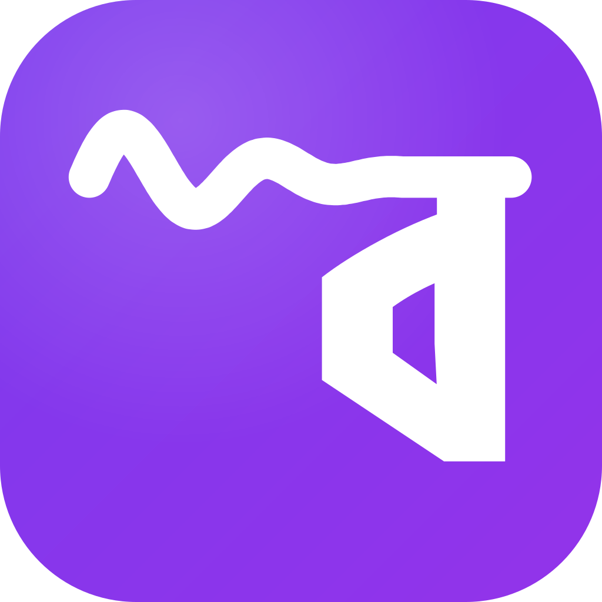

# Bou — বাংলা ভয়েস কীবোর্ড

**বলো, লেখা হয়ে যাবে।** Speak Bengali, with English words mixed in, and Bou writes Bengali
words in Bengali script and keeps English words in English.

Website: **https://bou-keyboard.vercel.app** · Made by **[Subrata Mohajan](https://subrata.fedardokan.com)**

## What it does

- Uses Google's Rambler voice typing (natural dictation) on any Android 10+ arm64 phone, no root.
- Converts Rambler's Banglish output to Bengali script offline, word by word:
  `ami office e meeting e jabo` → `আমি office এ meeting এ যাবো`.
- Understands regional speech from Chittagong, Sylhet and Barisal (4,000+ dialect words;
  81.8% word accuracy on 2,940 romanized ONUBAD sentences), plus common Dhaka forms.
- Optional **AI mode**: with your own free Gemini key (Google AI Studio) the whole sentence is
  rewritten with context, which helps regional speech and misheard words. Off by default; with no
  key or no internet the offline converter is used.
- In-app updates from this repo's GitHub Releases.
- Installs beside stock Gboard as a separate app (`com.subratamohajan.bou`).

## Install

**APK (easiest):** download `Bou.apk` from the
[latest release](https://github.com/subrata-mohajan/Bou/releases/latest), install it, then
Settings → System → Languages & input → On-screen keyboard → turn on **Bou**. In Bou's settings
pick Voice typing → Dictation type → **Rambler**. Step-by-step in Bangla:
https://bou-keyboard.vercel.app/install

**Patch it yourself (Morphe Manager):** add this patch source
`https://raw.githubusercontent.com/subrata-mohajan/Bou/main/patches-bundle.json`, pick stock
Gboard **18.6.3.100** (arm64), select all patches and install. Guide:
https://bou-keyboard.vercel.app/patch

## Privacy

Voice goes to Google's speech servers, exactly as in Gboard. The Banglish-to-Bengali conversion
runs on the phone. AI mode, only when you turn it on, sends the dictated text to Google Gemini
with your own key. Bou itself collects nothing.

## Build from source

See [docs/RELEASING.md](docs/RELEASING.md): JDK 21, Android SDK build-tools 36.1.0, a GitHub
token with `read:packages`, and stock Gboard 18.6.3.100.

## Contribute and contact

- A Bengali or regional word came out wrong? [Report the word](https://github.com/subrata-mohajan/Bou/issues/new?template=wrong-word.yml) — this grows the word list for everyone.
- Bugs and ideas: [Issues](https://github.com/subrata-mohajan/Bou/issues/new/choose). Questions: [Discussions](https://github.com/subrata-mohajan/Bou/discussions).
- Code: read [CONTRIBUTING.md](CONTRIBUTING.md).
- Talk to the maker: [Subrata Mohajan](https://subrata.fedardokan.com).
- Like Bou? [Support the maker on SupportKori](https://www.supportkori.com/subratamohajan) (bKash, Nagad, card).

## Licence and credits

Bou is free software under the **GNU GPL v3.0** (see [LICENSE](LICENSE)).

- Based on **[PixelBoard](https://github.com/Akshayykadam/PixelBoard)** by **Akshay Kadam** and its
  contributors (GPL-3.0). The original README with full upstream credits is kept in
  [docs/UPSTREAM-PIXELBOARD-README.md](docs/UPSTREAM-PIXELBOARD-README.md).
- Word frequencies: **[FrequencyWords](https://github.com/hermitdave/FrequencyWords)** by Hermit
  Dave, from OpenSubtitles 2018 (CC BY-SA 4.0).
- Regional words: **[ONUBAD](https://data.mendeley.com/datasets/6ft99kf89b/2)** by Nusrat Sultana,
  Rumana Yasmin, Bijon Mallik and Mohammad Shorif Uddin (CC BY 4.0).
- Patching toolchain: the ReVanced and Morphe communities.

Bou is not affiliated with or endorsed by Google. Gboard is a trademark of Google LLC.
